# Modern-UI für die Helden-Software (DSA 4.1)

Ein Plugin für die [Helden-Software](https://www.helden-software.de/), das ihr eine moderne Oberfläche,
übersichtlichere Reiter für Inventar und Ausrüstung, hilfreiche Tooltips und einen neu gestalteten Heldenbogen gibt. Alle Funktionen der Helden-Software bleiben
erhalten. Das Plugin nutzt ausschließlich die offizielle Plugin-Schnittstelle und verändert keine Heldendateien.
Mit einem Klick lässt sich jederzeit zum Original-Design zurückschalten.

| Modern hell | Original |
|---|---|
| 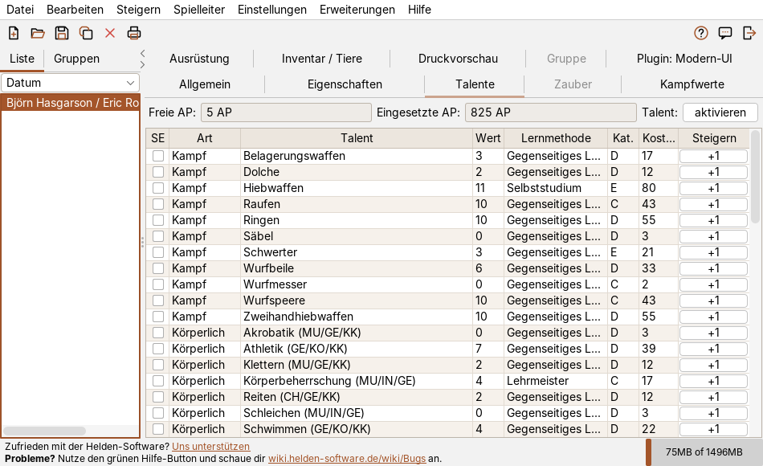 | 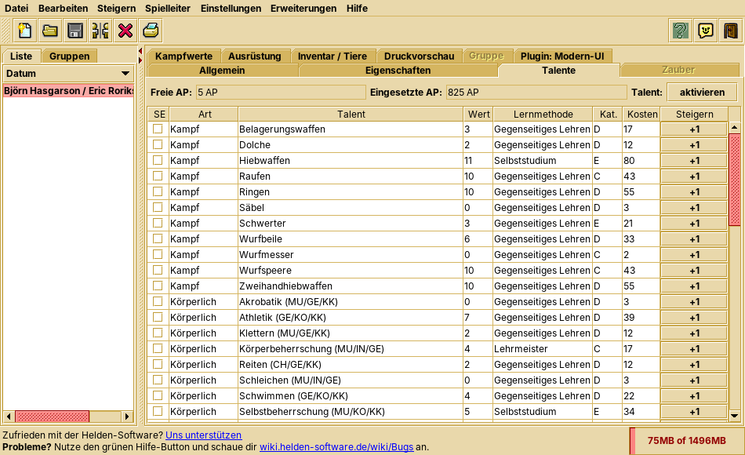 |

## Inhalt

- [Funktionen](#funktionen)
  - [Moderne Oberfläche](#moderne-oberfläche)
  - [Inventar, Hinzufügen und Geldbörse](#inventar-hinzufügen-und-geldbörse)
  - [Ausrüstung](#ausrüstung)
  - [Tooltips und eigene Notizen](#tooltips-und-eigene-notizen)
  - [Steigerungen rückgängig machen](#steigerungen-rückgängig-machen)
  - [Reiter „Plugin: Modern-UI“](#reiter-plugin-modern-ui)
  - [Moderner Heldenbogen](#moderner-heldenbogen)
- [Installation](#installation)
  - [Automatische Aktualisierung](#automatische-aktualisierung)
- [Bedienung](#bedienung)
- [Selbst bauen](#selbst-bauen)
- [Aufbau des Quellcodes](#aufbau-des-quellcodes)
- [Getestete Fälle](#getestete-fälle)
- [Hinweise](#hinweise)

## Funktionen

### Moderne Oberfläche

- **Drei Designs:** *Modern hell*, *Modern dunkel* und *Original*. Das gewählte Design gilt für die ganze
  Software einschließlich aller Dialoge (Steigern, Erschaffung, Ausrüstung …).
- **Gut unterscheidbare Felder:** Tabellen mit Zebra-Streifen, Spaltenlinien und gut lesbarer Markierung.
  Bearbeitbare Eingabefelder sind hell, reine Anzeigefelder leicht getönt.
- **Sortierbare Talente und Zauber:** In den Reitern „Talente“ und „Zauber“ sortiert ein Klick auf den
  Spaltenkopf (z. B. *Kosten*, *Wert*, *Kat.*/*Komp*, *Talent*, *Merkmale*), ein zweiter Klick kehrt die Reihenfolge
  um, ein dritter stellt die ursprüngliche wieder her. Steigern mit *+1* und *SE* funktionieren auch sortiert.
- **Eigene Symbole:** über 40 neu gezeichnete Symbole für Werkzeugleiste, Dialoge, Meldungen und die
  Markierungen in Talent- und Zauberlisten (Basistalent, Hauszauber, Leittalent …), außerdem für die
  Heldengruppen, die Ordner im Gruppenvergleich und die Löschknöpfe im Inventar. Sie passen sich
  hellem und dunklem Design an. Im Design *Original* erscheinen wieder die ursprünglichen Symbole.

| Modern dunkel | Neue Symbole (hell und dunkel) |
|---|---|
| 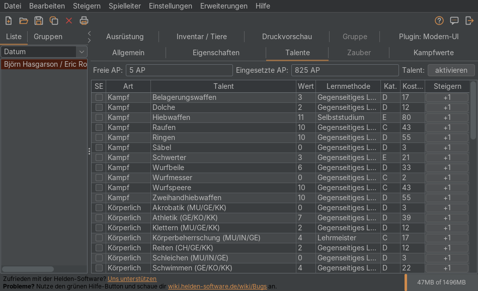 | 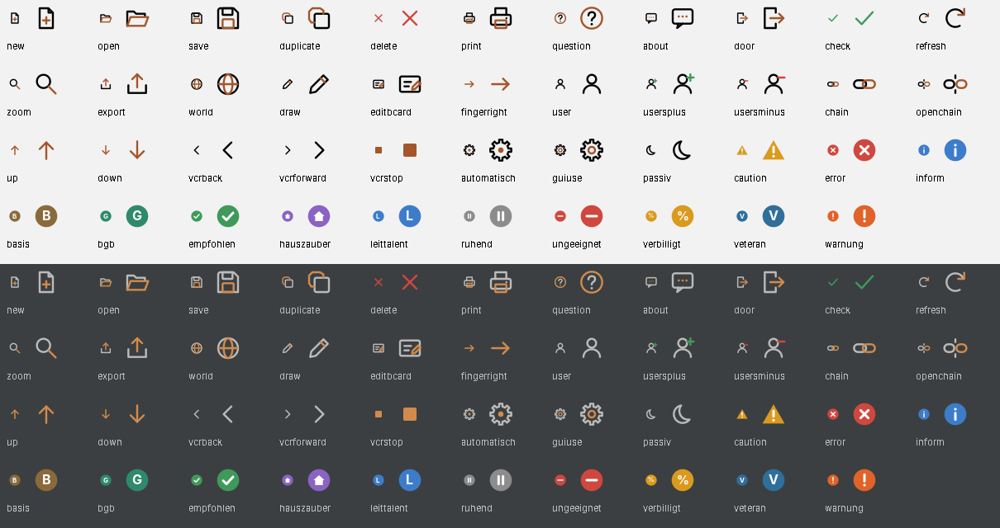 |

### Inventar, Hinzufügen und Geldbörse

In den Designs *Modern hell* und *Modern dunkel* sind der Reiter „Inventar / Tiere“ und seine Dialoge neu
angeordnet. Es sind dieselben Bedienelemente der Helden-Software; alle Änderungen am Helden laufen weiter
über sie. Heldendateien und andere Plugins bleiben unberührt, im Design *Original* sieht alles aus wie bisher.

- **Inventar:** Übersicht oben mit Anzahl der Einträge, Gesamtgewicht in Stein und Unzen und Inhalt der
  Geldbörse. Suchfeld, Filter nach Art und *Nach Art gruppieren* (Trennlinie und Art nur am Gruppenanfang).
  Die Spalten +, − und ✕ sind schmal, Name und Art bekommen mehr Platz. Eine per Spaltenkopf gewählte
  Sortierung bleibt erhalten. Doppelklick auf eine Zeile öffnet *Editieren* – auch bei sortierter oder
  gefilterter Ansicht für den richtigen Gegenstand. Über einem ausgegrauten „−“ bzw. „✕“ erklärt ein Tooltip,
  warum es gesperrt ist (ausgerüstet und erst abzulegen bzw. nur noch ein Stück).
- **Gegenstand hinzufügen:** links Suche, Kategorie und Gegenstandsliste, rechts die Angaben zum markierten
  Gegenstand (Art, Gewicht, Wert, Kampf- bzw. Rüstungswerte, Quelle) mit *Anzahl* und *Hinzufügen*,
  darunter das Inventar. `↓` springt aus der Suche in die Liste. Ein Klick auf einen
  Gegenstand im Inventar zeigt oben dessen Angaben; *Editieren* ist nur für Gegenstände im Inventar aktiv.
  *Kaufen (Preis)* fügt hinzu und bezahlt gleich aus der Geldbörse (Mittelreich, bei Bedarf mit Wechseln) –
  über den Geldbörsen-Dialog der Helden-Software, die Änderung steht also auch in ihrem Protokoll.
  Reicht das Geld nicht, wird nichts hinzugefügt.
  Gegenstände lassen sich auch per Doppelklick oder durch Ziehen ins Inventar übernehmen; dann fragt das Plugin nach der Anzahl
  und ob der Gegenstand gekauft (bezahlt) oder ohne Bezahlen gegeben werden soll.
- **Geldbörse:** *Ein- und Ausgaben* – Betrag eingeben und *Einnehmen* oder *Ausgeben*. Beim Ausgeben
  wird bei Bedarf gewechselt (z. B. ein Silbertaler in Heller). Dazu der Gesamtwert in Silbertalern.
  Übernommen wird wie bisher erst mit *OK*, *Abbrechen* verwirft alles.

Die Dialoge passen sich der Bildschirmgröße an, sodass *OK* und *Abbrechen* immer erreichbar bleiben.

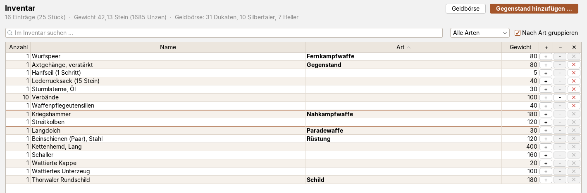

| Gegenstand hinzufügen | Geldbörse |
|---|---|
| 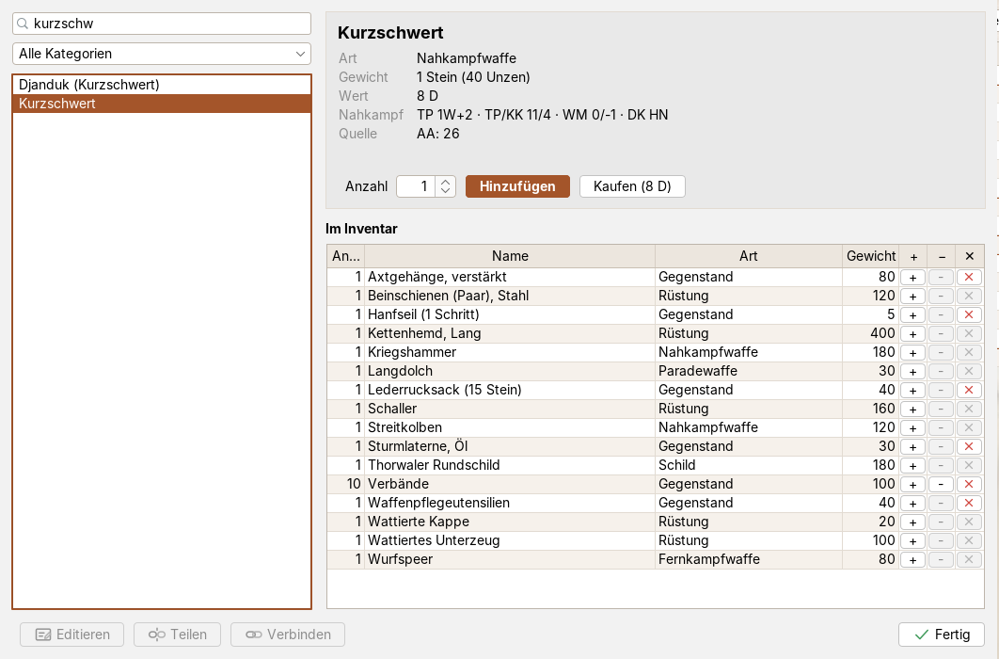 | 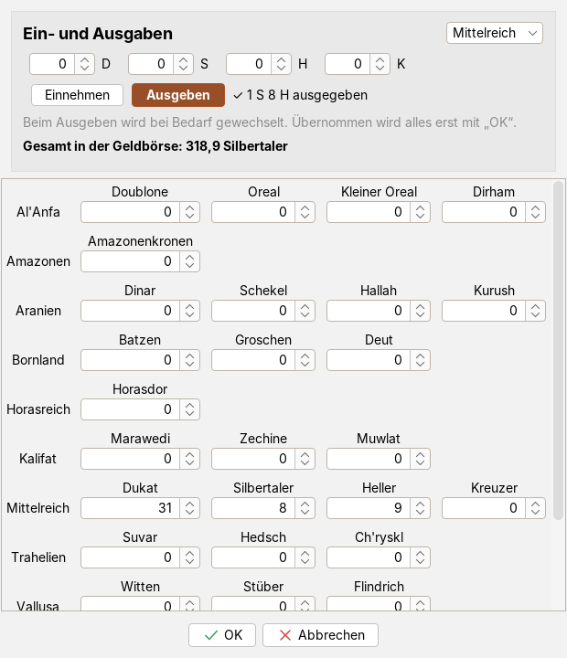 |

### Ausrüstung

Auch der Reiter „Ausrüstung“ ist in den modernen Designs neu gestaltet; im Design *Original* bleibt er wie bisher.

Die drei Ausrüstungssets sind alternative Ausrüstungen (z. B. Reise, Kampf, Stadt); die Helden-Software kennt
kein „aktives“ Set, sondern berechnet die Werte für jedes Set einzeln.

- **Übersicht:** Jedes Set als Karte (leere Sets mit „leer“ markiert). Oben eine Figur mit dem Rüstungsschutz
  je Körperzone und die Summen (Rüstungsschutz, Behinderung, Gewicht, Initiative, Ausweichen). Darunter nur die
  belegten Plätze mit ihren Werten (AT/PA/TP, FK, Schild-PA/WM, RS/BE und Zonen) – auch mehr als fünf
  Rüstungsteile und umbenannte Gegenstände. Leere Bereiche zeigen „+ … anlegen“; fehlen passende Gegenstände
  im Inventar, steht dort der Grund.
- **Ablegen mit ✕:** Das rote „✕“ hinter einem Gegenstand legt ihn direkt ab, ohne *Bearbeiten* (er bleibt im
  Inventar). Das erledigt im Hintergrund der Dialog der Helden-Software, die alle Werte selbst neu berechnet;
  ein Fenster erscheint dabei nicht.
- **Bearbeiten:** Die Dialoge der Helden-Software (Nahkampf, Fernkampf, Schilde/Parierwaffen, Rüstung) sind neu
  angeordnet: Plätze links als Zeilen, rechts die Gegenstände mit ihren Werten. Doppelklick legt einen Gegenstand
  auf den nächsten freien Platz, Ziehen auf einen bestimmten Platz; bei der Rüstung legt Doppelklick bzw. Ziehen an
  oder ab. Beschriftungen und Tooltips erklären „Werte …“ (Bruchfaktor, Talent), die Schild-Zuordnung, Hand und
  Beidhändigen Kampf. Übernommen wird wie bisher mit *OK*.

| Ausrüstung | Nahkampfwaffen bearbeiten |
|---|---|
| 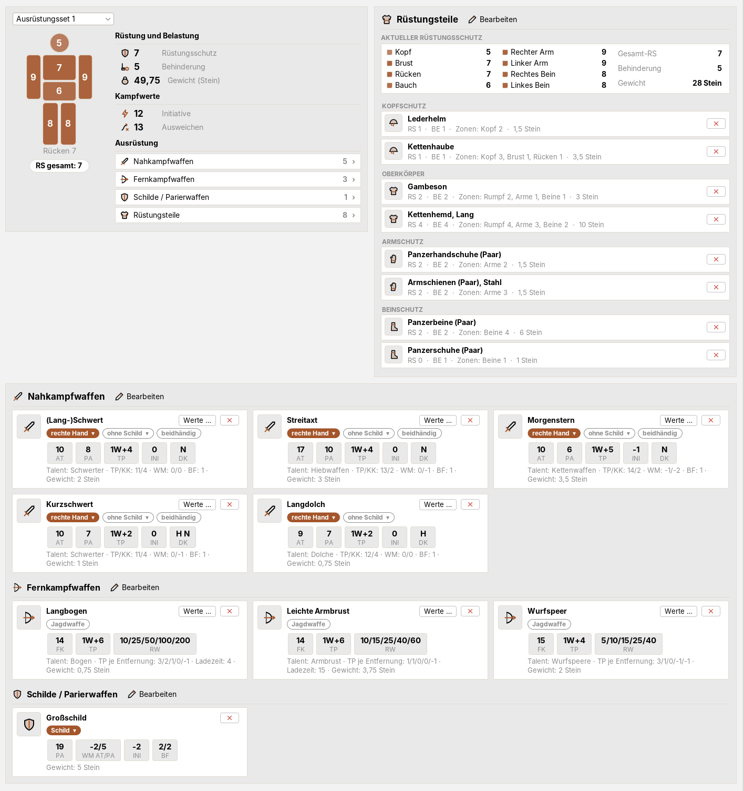 | 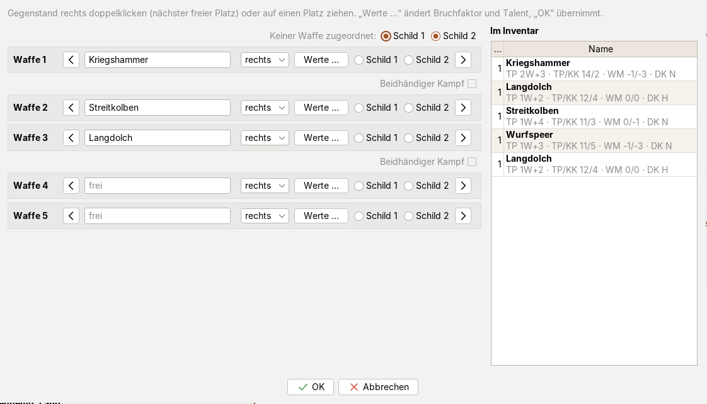 |

### Tooltips und eigene Notizen

- **Tooltips** zu Talenten, Sonderfertigkeiten, Vor- und Nachteilen und Zaubern – überall in der Software,
  auch in den Original-Dialogen. Bei eigenen Talenten mit Probe und Eigenschaftswerten, TaW, BE bzw. AT/PA.
  Meta-Talente (Ansitzjagd, Kräuter suchen, Wachehalten …) erklären zusätzlich, aus welchen Talenten die
  Helden-Software ihren Wert berechnet.
- **Herkunft eines Werts:** Startwert aus Rasse, Kultur und Profession, Professions-Auswahl, Steigerungen bei
  der Erschaffung und jede spätere Steigerung mit Datum, Lernmethode (Lehrmeister, Selbststudium …),
  Spezieller Erfahrung und AP-Kosten. Grundlage ist das Ereignisprotokoll der Helden-Software.
- **Herkunft der Abenteuerpunkte** (Reiter „Allgemein“ und Plugin-Reiter): AP aus der Erschaffung, jede
  AP-Vergabe mit Datum und Anlass, Ausgaben nach Bereich und freie AP.
- **Eigene Notizen:** Doppelklick auf einen Eintrag oder Maus darüber und `Strg+Umschalt+T`.
  Notizen erscheinen im Tooltip und auf dem Heldenbogen. Lange Notizen werden im Tooltip gekürzt und auf
  dem Bogen vollständig gedruckt.

| Herkunft eines Talentwerts | Herkunft der Abenteuerpunkte |
|---|---|
| 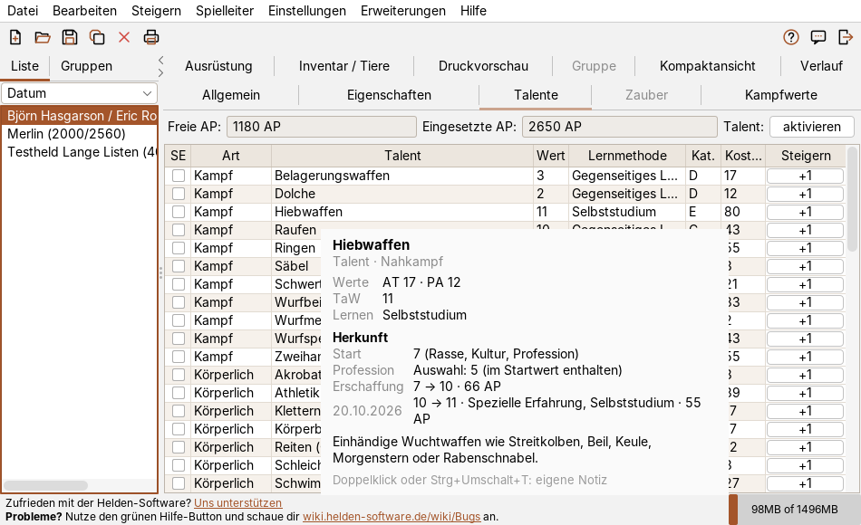 | 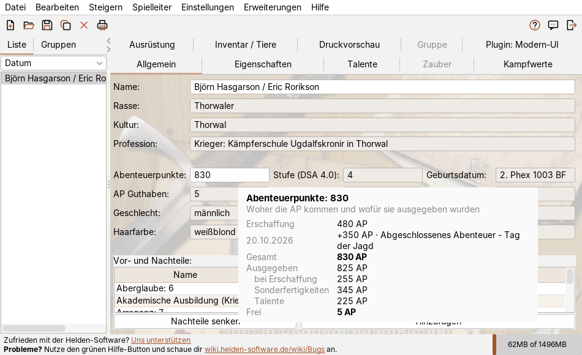 |

### Steigerungen rückgängig machen

Im Reiter „Plugin: Modern-UI“ → *Verlauf* stehen alle Steigerungen und erworbenen Sonderfertigkeiten aus
dem Ereignisprotokoll (neueste zuerst). Ein Eintrag lässt sich mit *Rückgängig machen …* zurücknehmen;
die AP werden erstattet und der Eintrag verschwindet aus dem Protokoll.

- Möglich für: Talent, Zauber, Nahkampftalent (inkl. AT/PA-Verteilung) und Eigenschaft (auch LE/AU/AE) steigern,
  Talent aktivieren, Sonderfertigkeit hinzugefügt. Erschaffung und AP-Vergaben bleiben unangetastet.
- Es muss die jeweils letzte Änderung an diesem Talent/dieser SF sein (z. B. erst „Rechnen 3 → 4“,
  dann „Rechnen 2 → 3“). Andere Talente dürfen danach gesteigert worden sein.
- Das Zurückrechnen übernimmt die Helden-Software selbst (ihre eigene Undo-Logik). Sie prüft vorher, ob der
  aktuelle Wert noch zum Ereignis passt; sonst wird nichts verändert.
- Eine dabei genutzte Spezielle Erfahrung wird nicht automatisch zurückgegeben.
- **Sonderfertigkeiten mit Voraussetzung:** Setzen andere SF des Helden die gewählte voraus (auch über mehrere
  Stufen, z. B. Parierwaffen I → Binden → Entwaffnen), zeigt der Dialog einen Warnhinweis mit allen betroffenen
  SF und der Gesamterstattung. Nach Bestätigung werden sie mit zurückgesetzt (neueste zuerst). Grundlage sind die
  Voraussetzungen der Helden-Software selbst; bei „oder“-Voraussetzungen bleibt eine SF erhalten, solange der Held
  noch eine andere Alternative besitzt (z. B. Binden mit Meisterparade). SF ohne Eintrag im Verlauf (etwa von der
  Erschaffung) werden im Hinweis genannt, aber nicht automatisch entfernt.
- Dauerhaft wird die Änderung erst beim Speichern des Helden. Vorher eine Sicherung des Helden anzulegen,
  ist trotzdem empfehlenswert.

### Reiter „Plugin: Modern-UI“

Eine kompakte Heldenübersicht: Eigenschaften und Basiswerte als Kacheln, filterbare Talentliste mit
Fortschrittsbalken (Meta-Talente in einer eigenen Gruppe, sofern sie für den Helden eingeschaltet sind), Sonderfertigkeiten und Vor-/Nachteile mit Kurzbeschreibung, Kampfwerte, Zauber und
Inventar mit Geldbörse. Die Übersicht aktualisiert sich automatisch.

Das **Inventar** ist eine sortier- und filterbare Tabelle (Alle, Angelegt, Waffen, Rüstung, Schilde, Sonstiges)
mit Anzahl, Gewicht in Stein, Wert (D/S/H/K) und angelegten Gegenständen. Die Spalte *Werte* zeigt die Angaben
aus dem ersten belegten Ausrüstungsset: TP, TP/KK, AT/PA, INI, WM, BF und DK bei Nahkampfwaffen, TP, FK und Reichweite bei
Fernkampfwaffen, PA und WM bei Schilden sowie RS, BE und den Schutz je Trefferzone bei Rüstungen. Darüber stehen
Gesamtgewicht und Gesamtwert. Dieselben Angaben erscheinen als Tooltip – hier und im Reiter *Inventar / Tiere*
der Helden-Software – zusammen mit Einzelgewicht, Einzelpreis und Quelle. Auch beim *Hinzufügen* zeigt die
Liste „Gegenstände“ zu jeder Vorlage Art, Gewicht, Wert, Quelle und die Waffen-, Schild- bzw. Rüstungswerte.
Umrechnungen: 1 Dukat = 10 Silbertaler = 100 Heller = 1000 Kreuzer, 1 Stein = 40 Unzen = 1 kg.

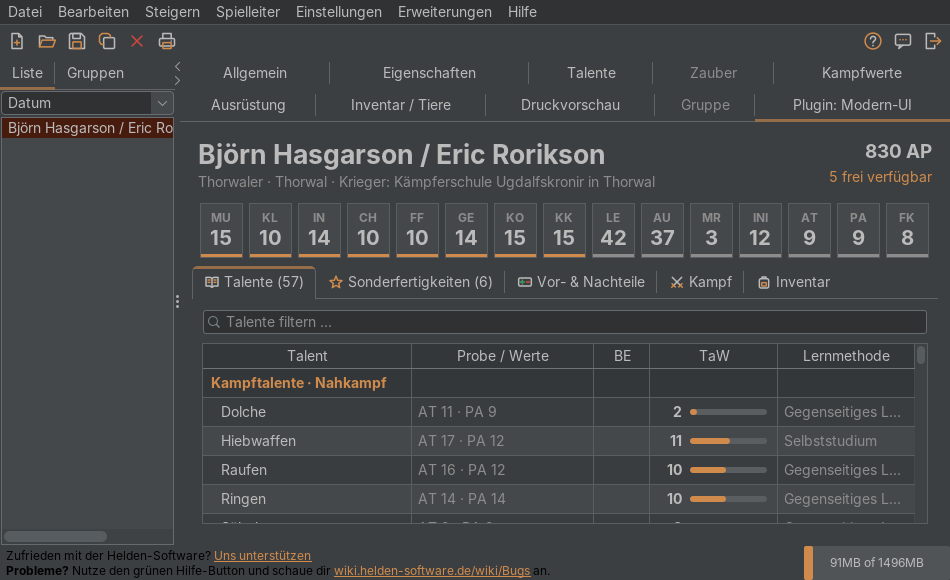

### Moderner Heldenbogen

Im Reiter „Druckvorschau“ zeigt das Plugin einen neu gestalteten Heldenbogen (A4) mit Drucken und
PDF-Export. Über den Umschalter *Original* ist die bisherige Druckvorschau mit allen Bogenvarianten
weiterhin erreichbar.

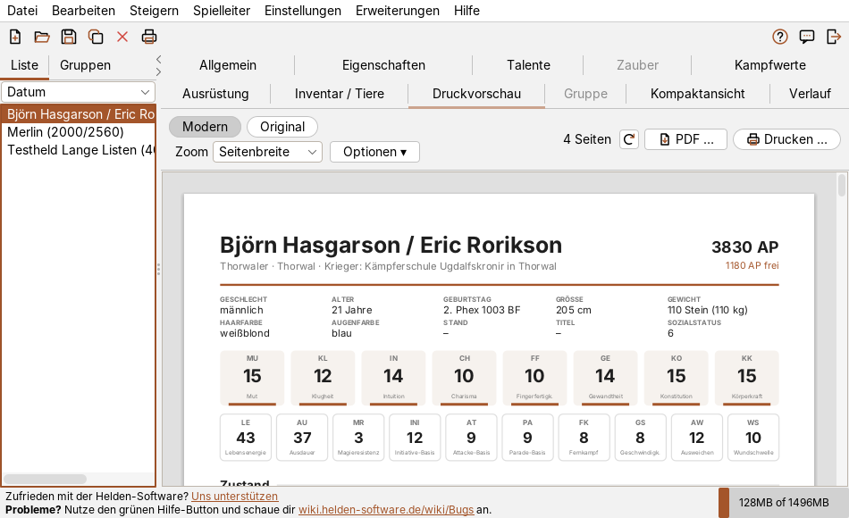

**Inhalt des Bogens**

- **Kopf und Werte:** Name, Rasse, Kultur, Profession, Steckbrief (Gewicht in Stein mit kg), Eigenschaften
  und Basiswerte.
- **Zustand:** LE und AU mit ½-, ⅓- und ¼-Schwellen.
- **Kampf:** Nah- und Fernkampfwaffen, Schilde und Parierwaffen, Rüstungszonen mit W20-Bereichen,
  Behinderung durch Rüstung, Initiative-Rechnung je Waffe (INI-Basis − BE + Waffen-/Schild-Mod. + 1W6) und
  eine Trefferzonen-Tabelle mit Wundkästchen je Zone.
- **Sonderfertigkeiten, Vor- und Nachteile** mit Kurzbeschreibung bzw. eigener Notiz.
- **Talente** nach Gruppen mit Probe, aktuellen Eigenschaftswerten, BE, Steigerungsspalte und TaW;
  auf Wunsch mit Meta-Talenten.
- **Magie-Seite** am Ende des Bogens (nur für Zauberkundige bzw. Geweihte): Astral- bzw. Karmaenergie als Zahlenleiste für
  einen Marker und Verlaufsprotokoll – so muss nichts radiert werden. Dazu eine Zauberübersicht mit Probe,
  ZfW, AsP-Kosten, Eckdaten, Anmerkung aus der Helden-Software und eigener Notiz.
- **Kennzeichen** wie im Original-Bogen als kleine farbige Plaketten mit Legende: **MH** Meisterhandwerk,
  **L** Leittalent bzw. Leitzauber, **M+**/**M−** Mirakel, **HZ** Hauszauber, **A** Ausdauerschaden,
  **S1**, **S2** … Kombination mit Schild/Parierwaffe, **J** Jagdwaffe.
- **Inventar** mit Gewichten, Gesamtgewicht und leeren Zeilen zum Eintragen.
- **Geldbörse** mit Dukaten, Silbertalern, Hellern und Kreuzern, Gesamtwert und Umrechnung
  (1 D = 10 S = 100 H = 1000 K); fremde Währungen werden gesondert aufgeführt.
- **Notizseite** mit Feld für die Charakterbeschreibung, Portrait und Linien für weitere Notizen.

Lange Listen und Notizen laufen sauber über Spalten und Seiten weiter, lange Namen werden umbrochen statt
abgeschnitten.

| Seite 1 | Kampf und Initiative |
|---|---|
| 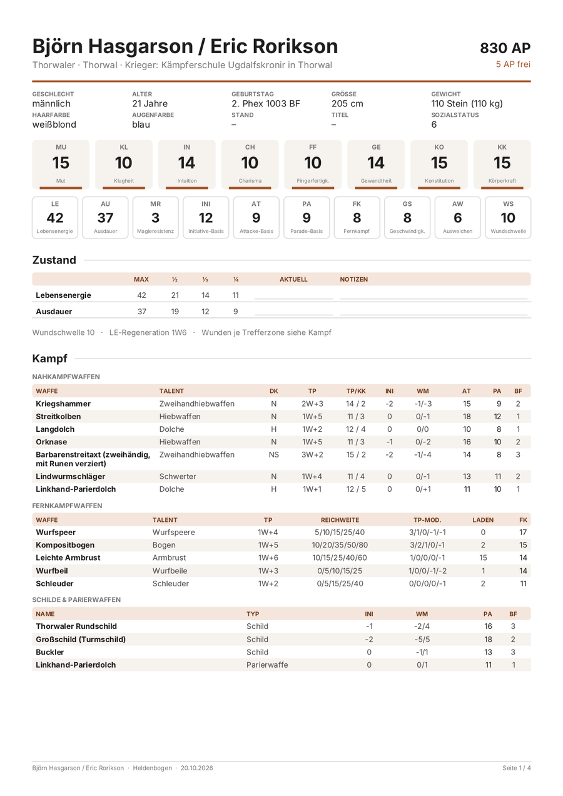 | 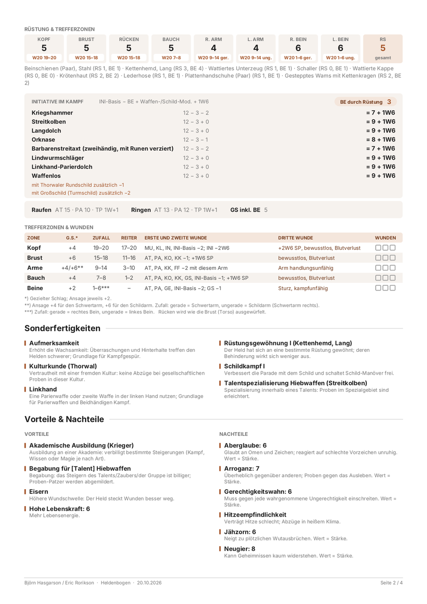 |

| Talente | Magie-Seite |
|---|---|
| 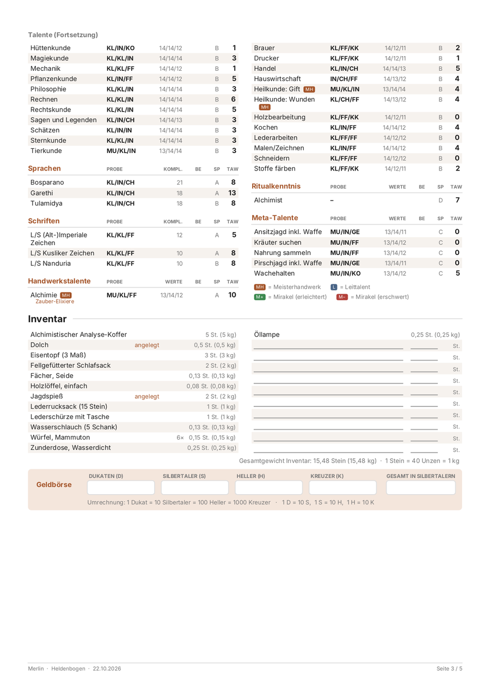 | 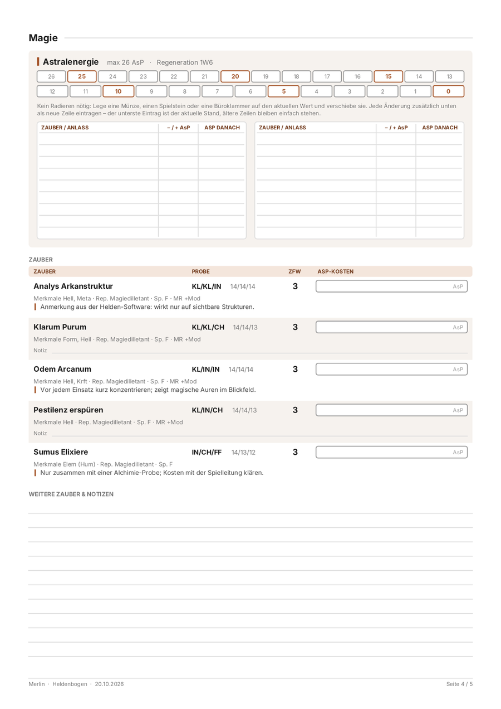 |

| Inventar, Geldbörse und Notizen | |
|---|---|
| 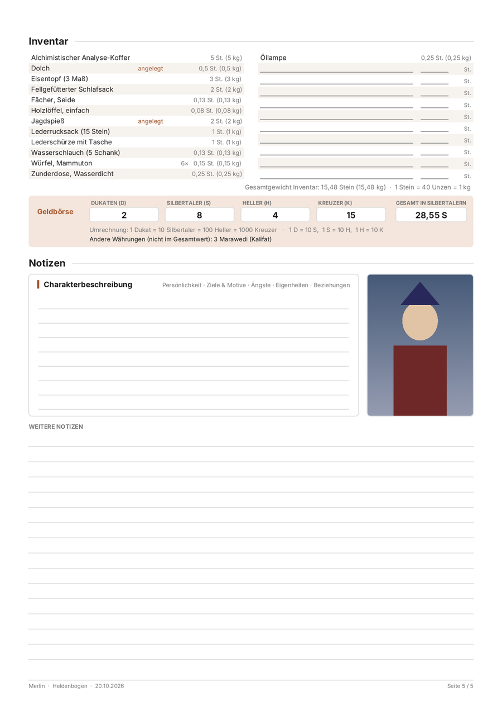 | |

**Optionen** (Knopf *Optionen ▾* in der Druckvorschau)

| Option | Wirkung |
|---|---|
| Beschreibungen & eigene Notizen | Kurzbeschreibungen und eigene Notizen zu SF, Vor-/Nachteilen und Zaubern |
| Meta-Talente zeigen | Meta-Talente wie *Wache halten* (die Helden-Software liefert sie nur, wenn in ihren Druckeinstellungen „Metatalente“ aktiv ist – der Eintrag *Meta-Talente in der Helden-Software einschalten …* öffnet diese Einstellungen). Die Wahl wird je Held gespeichert und bleibt beim Heldenwechsel und nach einem Neustart erhalten |
| Notizfelder und Linienseite | Notizseite, Schreiblinien bei Zaubern und leere Inventarzeilen |
| Portrait neben der Charakterbeschreibung | Rahmen für ein Portrait; *Portrait wählen …* hinterlegt ein Bild je Held, sonst wird das Portrait aus der Helden-Software genutzt oder ein leeres Feld zum Zeichnen gedruckt |

## Installation

1. Helden-Software beenden.
2. `ModernUI-Plugin.jar` aus den [Releases](../../releases) bzw. den Build-Artefakten herunterladen.
3. In den Plugin-Ordner kopieren:
   - Windows: `C:\Users\<Name>\helden\plugins\`
   - macOS: `/Users/<Name>/helden/plugins/`
   - Linux: `~/helden/plugins/`
4. Helden-Software starten. Nach ein bis zwei Sekunden erscheint das moderne Design.

Deinstallation: JAR aus dem Plugin-Ordner löschen. Die Helden-Software sieht danach wieder genau so aus wie vorher.

### Automatische Aktualisierung

Das Plugin aktualisiert sich selbst, wenn in der Helden-Software unter *Einstellungen → Updater →
Automatisch Updaten* die automatische Aktualisierung (der `autoUpdater`) eingeschaltet ist. Der autoUpdater
selbst aktualisiert nur die Helden-Software, nicht die Plugins – deshalb übernimmt das Plugin das selbst:

- Höchstens einmal am Tag, kurz nach dem Start, wird das neueste Release dieses Repositorys abgefragt.
- Eine neuere Version wird heruntergeladen und geprüft: SHA-256-Prüfsumme aus der GitHub-Antwort,
  Plugin-Kennung und Versionsnummer im JAR. Passt etwas nicht, wird der Download verworfen.
- Installiert wird beim Beenden der Helden-Software (unter Windows ist die laufende Plugin-Datei gesperrt):
  Ein kleiner Hilfsprozess ersetzt `ModernUI-Plugin.jar`, die neue Version ist ab dem nächsten Start aktiv.
  Die bisherige Version liegt als Sicherung in `helden/plugins/modern-ui/update/ModernUI-Plugin-vorher.jar`,
  das Protokoll in `update.log` daneben.
- Von Hand: *Erweiterungen → Modern-UI → Nach Updates suchen …* (funktioniert auch bei ausgeschalteter
  automatischer Aktualisierung).

Die automatische Aktualisierung funktioniert ab Version 1.16.0 – ältere Versionen einmalig von Hand ersetzen.

## Bedienung

| Was | Wie |
|---|---|
| Design wechseln | *Erweiterungen → Modern-UI → Design: Modern hell / Modern dunkel / Original* |
| Tooltips an/aus | *Erweiterungen → Modern-UI → Erweiterte Tooltips anzeigen* (gilt überall, auch im Reiter „Plugin: Modern-UI“) |
| Eigene Notiz anlegen | Doppelklick auf einen Eintrag, oder Maus darüber und `Strg+Umschalt+T`, oder im Plugin-Reiter per Rechtsklick |
| Ordner mit den Notizen öffnen | *Erweiterungen → Modern-UI → Ordner mit eigenen Tooltip-Texten öffnen* |
| Gegenstand hinzufügen | Reiter *Inventar / Tiere* → *Gegenstand hinzufügen …* → suchen, markieren, *Hinzufügen*, Doppelklick oder in das Inventar ziehen |
| Gegenstand kaufen | Wie *Gegenstand hinzufügen*, dann *Kaufen (Preis)* statt *Hinzufügen* |
| Ausrüstung anlegen | Reiter *Ausrüstung* → *Bearbeiten* beim Bereich → Gegenstand doppelklicken oder auf einen Platz ziehen → *OK* |
| Ausrüstung ablegen | Reiter *Ausrüstung* → rotes „✕“ hinter dem Gegenstand |
| Geld einnehmen / ausgeben | Reiter *Inventar / Tiere* → *Geldbörse* → Betrag eingeben → *Einnehmen* bzw. *Ausgeben* → *OK* |
| Heldenbogen drucken / als PDF | Reiter *Druckvorschau* → *Drucken …* bzw. *PDF …* |
| Steigerung / SF rückgängig machen | Reiter *Plugin: Modern-UI* → *Verlauf* → Eintrag wählen → *Rückgängig machen …* |
| Nach Updates suchen | *Erweiterungen → Modern-UI → Nach Updates suchen …* (automatisch: siehe [Automatische Aktualisierung](#automatische-aktualisierung)) |

Doppelklick öffnet die Notiz nur dort, wo die Helden-Software selbst nichts mit einem Doppelklick macht
(z. B. nicht in bearbeitbaren Zellen).

**Eigene Notizen** werden in `helden/plugins/modern-ui/eigene-tooltips.tsv` gespeichert (eine Zeile pro
Eintrag: `Name<TAB>Text`, Zeilenumbruch als `\n`). Die Datei bleibt auf deinem Rechner und ist nicht Teil
dieses Repositorys. Auszüge aus eigenen Regelbüchern sind für den privaten Gebrauch gedacht – die Datei
bitte nicht weitergeben.

## Selbst bauen

Voraussetzung: JDK 8 oder neuer.

```sh
./build.sh            # Ergebnis: build/ModernUI-Plugin.jar
```

Das Skript lädt FlatLaf von Maven Central (oder nimmt das JAR aus der Umgebungsvariable `FLATLAF_JAR`).
Die Helden-Software wird zum Bauen **nicht** benötigt: Der Ordner `api-stubs/` enthält nur die Signaturen
der drei verwendeten Plugin-Schnittstellen. Sie dienen nur zum Kompilieren und werden nicht ins Plugin gepackt.

GitHub Actions baut bei jedem Push und hängt das JAR als Artefakt an. Bei einem über die GitHub-Oberfläche
veröffentlichten Release (oder einem Tag `vX.Y.Z`) wird das JAR automatisch an das Release angehängt.
Die Versionsnummer kommt aus dem Tag, wenn er wie eine Version aussieht (z. B. `v1.16.0` oder `v.1.16.0`),
sonst aus der Datei `VERSION`. Für die automatische Aktualisierung muss das Release veröffentlicht (kein
Entwurf, keine Vorabversion) sein und `ModernUI-Plugin.jar` enthalten – das erledigt der Workflow.

## Aufbau des Quellcodes

| Pfad (`src/main/java/de/modernhelden/`) | Inhalt |
|---|---|
| `ModernHeldenPlugin.java` | Einstiegspunkt: Plugin-Schnittstelle, Menü, Einstellungen, Datenaustausch |
| `Theme.java` | Designwechsel (FlatLaf hell/dunkel/Original), Farben für unterscheidbare Felder |
| `ModernIcons.java`, `IconSwap.java` | Eigene Vektor-Symbole und deren Austausch bzw. Wiederherstellung |
| `TabellenStil.java` | Zebra-Streifen und Gitterlinien für die Tabellen der Helden-Software |
| `TooltipHook.java`, `TooltipDB.java` | Globale Tooltips, Doppelklick-Notizen, Kurzbeschreibungen und eigene Notizen |
| `VorlagenInfo.java` | Werte der Gegenstandsvorlagen (Hinzufügen-Dialog) über die Plugin-Schnittstellen der Helden-Software |
| `InventarInfo.java` | Angaben zu Gegenständen (Gewicht, Wert, Kampf- und Rüstungswerte) für Inventar und Tooltips |
| `Herkunft.java` | Auswertung des Ereignisprotokolls (Herkunft von Werten und Abenteuerpunkten) |
| `Rueckgaengig.java` | Steigerungen/SF über die Undo-Logik der Helden-Software zurücknehmen |
| `HeroPanel.java`, `HeroData.java` | Reiter „Plugin: Modern-UI“ |
| `Geld.java` | Münzen, Reihenfolge und Umrechnung |
| `update/` | Automatische Aktualisierung über GitHub-Releases (`PluginUpdate`) und Installationshelfer (`UpdateInstaller`) |
| `InventarLayout.java`, `HinzufuegenLayout.java`, `GeldboerseLayout.java` | Reiter „Inventar / Tiere“, Hinzufügen-Dialog und Geldbörse in den modernen Designs |
| `AusruestungLayout.java`, `AusruestungDialoge.java` | Reiter „Ausrüstung“ und seine Bearbeiten-Dialoge in den modernen Designs |
| `TalenteSortierung.java` | Sortierbare Tabellen in den Reitern „Talente“ und „Zauber“ (moderne Designs) |
| `DebugBaum.java` | Nur im Debug-Modus: Komponentenbaum offener Fenster für die Analyse ausgeben |
| `ErschaffungsLayout.java` | Platzierung des GP/AP-Felds im Erschaffungsdialog (moderne Designs) |
| `print/` | Druckvorschau, Heldenbogen-Layout (`ModernSheet`), Datenaufbereitung, PDF-Export |
| `src/main/resources/.../tooltips.tsv` | Kurzbeschreibungen (eigene Formulierungen) |
| `api-stubs/` | Platzhalter der Plugin-Schnittstelle, nur zum Kompilieren |
| `docs/bilder/` | Bilder für dieses README |

## Getestete Fälle

Der Heldenbogen wurde mit Testhelden geprüft – von „nichts“ bis „alles maximal“:

- sehr viele Einträge: 19 Nah- und 13 Fernkampfwaffen, 10 Schilde, 19 Rüstungsteile, 56 Sonderfertigkeiten,
  61 Vor-/Nachteile, 95 Zauber, über 200 Gegenstände, 7 Währungen, 300 AsP
- lange Namen und Notizen (bis 9 000 Zeichen, mit Absätzen und überlangen Wörtern)
- Minimalfälle: Held ohne Talente, Ausrüstung, Magie oder Namen; nur Nachteile; zauberkundig ohne Zauber;
  1 AsP bzw. 1 KaP; fehlende Bereiche in den Daten
- Designwechsel hell → dunkel → Original → hell in Hauptfenster, Dialogen und Plugin-Reiter
- Legenden der Kennzeichen in über 10 000 Varianten (Talente, Waffen, Zauber an jeder Seiten- und Spaltengrenze)
- Inventar, Hinzufügen, Kaufen, Geldbörse und Ausrüstung in der Helden-Software mit Testhelden: Sortieren und
  Filtern, Ziehen und Doppelklick, Wechseln beim Bezahlen, mehr als fünf Rüstungsteile, umbenannte Gegenstände,
  kleiner Bildschirm (680 Pixel Höhe)

## Hinweise

- Die Kurzbeschreibungen sind eigene Zusammenfassungen, keine Regeltexte. Maßgeblich sind die Regelbücher
  und die Berechnungen der Helden-Software.
- Die Helden-Software ist nicht Teil dieses Repositorys und darf hier nicht eingecheckt werden.
- Die Bilder in diesem README zeigen Testhelden; das Portrait ist ein Platzhalterbild.
- *Das Schwarze Auge* und *Aventurien* sind eingetragene Marken der Ulisses Spiele GmbH. Dieses Projekt ist
  ein inoffizielles Fan-Projekt und steht in keiner Verbindung zu Ulisses Spiele oder den Entwicklern der
  Helden-Software.
- Enthält [FlatLaf](https://www.formdev.com/flatlaf/) (Apache-Lizenz 2.0, siehe `LICENSE-FlatLaf.txt`).
