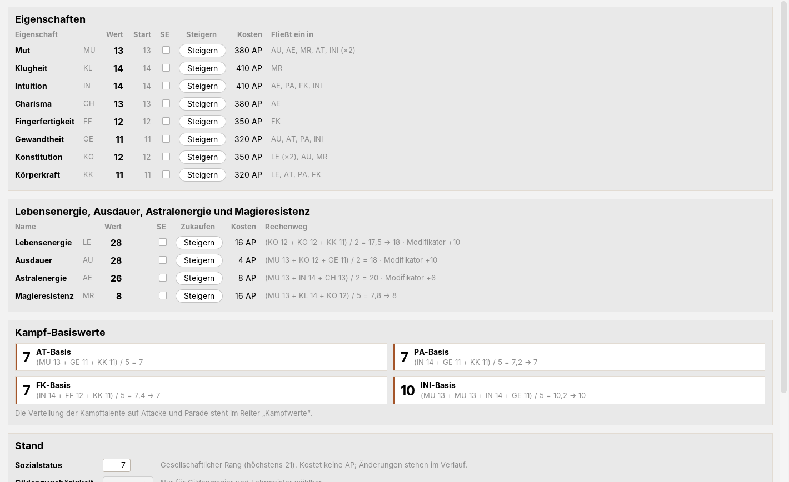
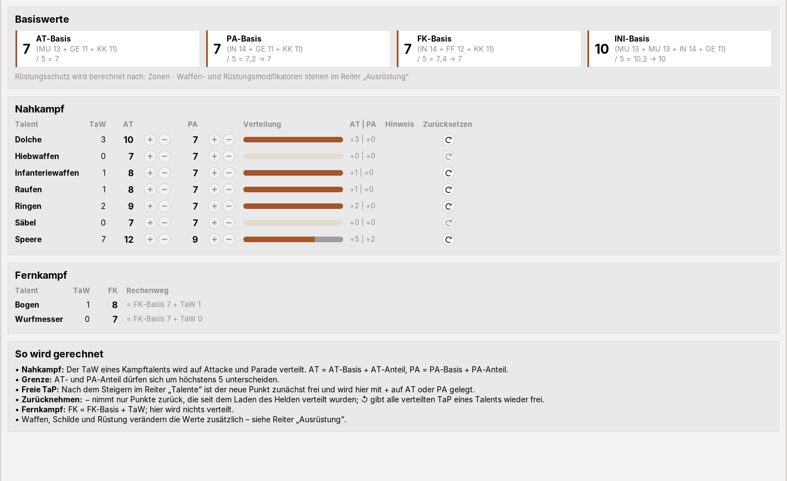
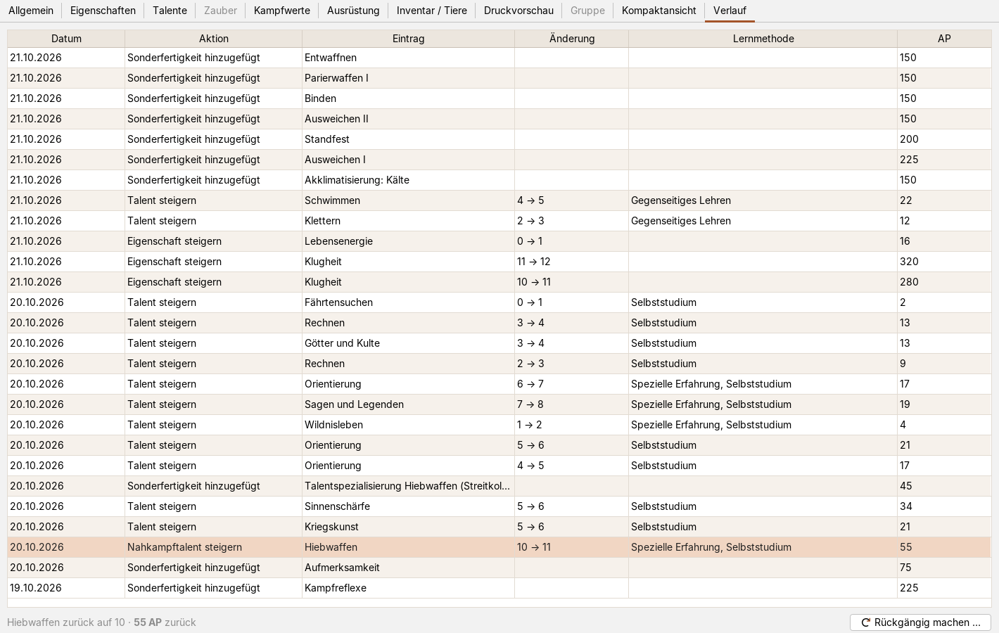
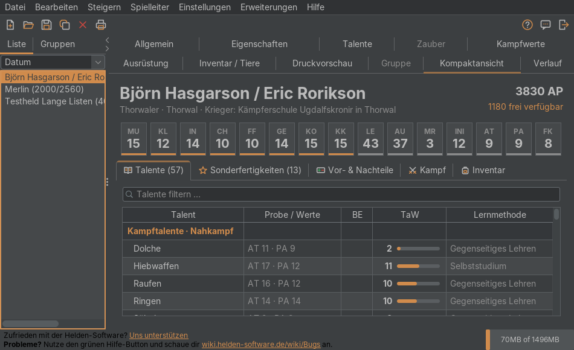

# Modern-UI für die Helden-Software (DSA 4.1)

Ein Plugin für die [Helden-Software](https://www.helden-software.de/): moderne Oberfläche, übersichtliches
Inventar und Ausrüstung, Tooltips, ein Verlauf zum Rückgängigmachen und ein neuer Heldenbogen. Es nutzt nur die
offizielle Plugin-Schnittstelle, verändert keine Heldendateien und lässt sich jederzeit auf das Original-Design
zurückschalten.

| Modern hell | Original |
|---|---|
|  |  |

## Inhalt

- [Funktionen](#funktionen)
- [Installation](#installation)
- [Bedienung](#bedienung)
- [Selbst bauen](#selbst-bauen)
- [Aufbau des Quellcodes](#aufbau-des-quellcodes)
- [Hinweise](#hinweise)

## Funktionen

### Oberfläche

- **Drei Designs:** *Modern hell*, *Modern dunkel* und *Original* – für die ganze Software samt Dialogen.
- **Lesbare Tabellen:** Zebra-Streifen, Spaltenlinien; bearbeitbare Felder hell, reine Anzeigen getönt.
- **Sortierbar:** Talente und Zauber per Klick auf den Spaltenkopf (aufsteigend, absteigend, ursprünglich);
  *+1* und *SE* funktionieren auch sortiert.
- **Eigene Symbole:** über 40 neu gezeichnete Symbole, passend zu hell und dunkel.

Die neu gestalteten Reiter *Eigenschaften*, *Inventar*, *Ausrüstung* und *Kampfwerte* samt Dialogen gibt es nur in den modernen Designs; im
*Original* sehen sie aus wie bisher.
Alle Änderungen am Helden laufen weiter über die Bedienelemente der Helden-Software.

| Modern dunkel | Neue Symbole |
|---|---|
|  |  |

### Eigenschaften

- **Eigenschaften als Tabelle:** Wert, Startwert, SE, *Steigern* mit Kosten und wofür die Eigenschaft gebraucht
  wird (z. B. „LE (×2), AU, MR“). Ist der Höchstwert erreicht, steht dort „Maximum“.
- **LE, AU, AE und MR mit Rechenweg:** Grundwert aus den Eigenschaften, Modifikator und Zukauf
  (z. B. „(KO 12 + KO 12 + KK 11) / 2 = 17,5 → 18 · Modifikator +10“); AE und KE nur bei Helden, die sie haben,
  dauerhaft verlorene AE mit *Zurückkaufen*.
- **Kampf-Basiswerte** mit Formel sowie **Sozialstatus** und **Gildenzugehörigkeit**.

### Inventar, Hinzufügen und Geldbörse

- **Inventar:** Anzahl, Gesamtgewicht und Geld auf einen Blick; Suche, Filter und Gruppierung nach Art;
  Sortierung bleibt erhalten; Doppelklick öffnet *Editieren*. Gesperrte „−“/„✕“ erklären per Tooltip, warum.
- **Gegenstand hinzufügen:** Suche und Liste links, Angaben (Gewicht, Wert, Kampf-/Rüstungswerte, Quelle)
  rechts. *Kaufen (Preis)* bezahlt gleich aus der Geldbörse, mit Wechseln und ohne dass sich ein Fenster
  zeigt. Doppelklick oder Ziehen ins Inventar fragt nach Anzahl und *Geben* oder *Kaufen*.
- **Geldbörse:** Betrag eingeben, *Einnehmen* oder *Ausgeben* – gewechselt wird automatisch.

| Gegenstand hinzufügen | Geldbörse |
|---|---|
|  |  |

### Ausrüstung

- **Übersicht:** Jedes der drei Sets als Karte mit Figur (RS je Zone), Summen (RS, BE, Gewicht, INI,
  Ausweichen) und den angelegten Gegenständen samt Werten. Ein „aktives“ Set gibt es in der Helden-Software nicht.
- **Ablegen mit ✕** direkt in der Übersicht, ohne *Bearbeiten*.
- **Bearbeiten:** Plätze links, Gegenstände rechts; Doppelklick legt auf den nächsten freien Platz, Ziehen auf
  einen bestimmten. Gegenstände mit zwei Arten (z. B. Langdolch) stehen nur einmal in der Liste.

| Ausrüstung | Nahkampfwaffen bearbeiten |
|---|---|
|  |  |

### Kampfwerte

- **Basiswerte erklärt:** AT-, PA-, FK- und INI-Basis mit Formel und den Eigenschaftswerten des Helden
  (z. B. „(MU 15 + GE 14 + KK 15) / 5 = 8,8 → 9“).
- **Nahkampf als Tabelle:** TaW, AT und PA je Talent, die Verteilung als Balken und die Anteile („+8 | +3“).
  Der Tooltip zeigt den Rechenweg (AT = AT-Basis + AT-Anteil …).
- **Verteilungsregeln:** freie TaP werden hervorgehoben; „+“ ist gesperrt, wenn keine TaP frei sind oder der
  Unterschied zwischen AT- und PA-Anteil schon 5 beträgt – mit Begründung im Tooltip. Verteilt wird über die
  Knöpfe der Helden-Software. **↺** gibt alle verteilten TaP eines Talents wieder frei, um neu zu verteilen.
- **Fernkampf:** FK mit Rechenweg (FK-Basis + TaW).

### Tooltips und eigene Notizen

- **Tooltips** zu Talenten, allen Sonderfertigkeiten, Vor-/Nachteilen und Zaubern, überall in der Software – mit
  Probe, Werten und bei Meta-Talenten der Berechnungsgrundlage.
- **Eigenschaften und Basiswerte:** Tooltips zu MU bis KK, LE, AU, AE, MR, INI, AT, PA und FK zeigen, worauf eine
  Eigenschaft wirkt bzw. wie sich ein Basiswert berechnet.
- **Herkunft eines Werts:** Startwert, Erschaffung und jede Steigerung mit Datum, Lernmethode, SE und AP.
- **Herkunft der AP:** Erschaffung, Vergaben mit Anlass, Ausgaben nach Bereich, freie AP.
- **Eigene Notizen:** Doppelklick oder `Strg+Umschalt+T`; erscheinen im Tooltip und auf dem Heldenbogen.

| Herkunft eines Talentwerts | Herkunft der Abenteuerpunkte |
|---|---|
|  |  |

### Verlauf: Steigerungen rückgängig machen

Der Reiter **Verlauf** listet alle Steigerungen und erworbenen Sonderfertigkeiten mit Datum, Änderung,
Lernmethode (inkl. SE) und AP. *Rückgängig machen …* nimmt einen Eintrag zurück und erstattet die AP –
gerechnet von der Helden-Software selbst, dauerhaft erst nach dem Speichern.

- Geht für Talente, Zauber, Kampftalente, Eigenschaften, aktivierte Talente und Sonderfertigkeiten – jeweils
  die letzte Änderung und nur Steigerungen um einen Punkt. Mit dem Editor geänderte Werte sind gekennzeichnet.
- SF, die die gewählte voraussetzen, werden nach Warnung mit zurückgesetzt. Eine genutzte SE kommt nicht zurück.
- Werte aus Import oder Eingabe eines Helden stehen nicht im Verlauf; ein leerer Verlauf erklärt das.

### Kompaktansicht

Der Plugin-Reiter („Kompaktansicht“) zeigt den Helden auf einen Blick: Eigenschaften als Kacheln,
filterbare Talentliste mit Balken (auch Meta-Talente), SF und Vor-/Nachteile mit Kurzbeschreibung,
Kampfwerte, Zauber und Inventar mit Waffen- und Rüstungswerten. Alle Tabellen sind sortierbar, Talente
innerhalb ihrer Gruppen. Kompaktansicht und Verlauf werden hinten angehängt, damit sich keine Reiter der
Helden-Software oder anderer Plugins verschieben.

### Moderner Heldenbogen

Im Reiter „Druckvorschau“ ein neu gestalteter A4-Bogen mit Drucken und PDF-Export; über *Original* bleibt die
bisherige Druckvorschau erreichbar.

- **Werte und Zustand:** Steckbrief, Eigenschaften, Basiswerte, LE/AU mit Schwellen.
- **Kampf:** Waffen, Schilde, Rüstungszonen mit W20-Bereichen, Initiative je Waffe, Trefferzonen mit Wundkästchen.
- **SF, Vor-/Nachteile und Talente** mit Kurzbeschreibung bzw. Notiz, Talente nach Gruppen (optional mit Meta-Talenten).
- **Magie-Seite** für Zauberkundige und Geweihte: AsP/KaP-Leiste zum Abhaken und Zauberübersicht.
- **Inventar, Geldbörse und Notizseite** mit Portrait.
- **Kennzeichen** als Plaketten mit Legende (MH, L, M+/M−, HZ, A, S1/S2, J).

Lange Listen laufen über Spalten und Seiten weiter. Unter *Optionen ▾* lassen sich Beschreibungen,
Meta-Talente (je Held gespeichert), Notizfelder und Portrait ein- und ausschalten.

| Seite 1 | Kampf und Initiative |
|---|---|
|  |  |
| **Talente** | **Magie-Seite** |
|  |  |
| **Inventar, Geldbörse und Notizen** | |
|  | |

## Installation

1. Helden-Software beenden.
2. `ModernUI-Plugin.jar` aus den [Releases](../../releases) herunterladen.
3. In den Plugin-Ordner kopieren: Windows `C:\Users\<Name>\helden\plugins\`, macOS `/Users/<Name>/helden/plugins/`,
   Linux `~/helden/plugins/`.
4. Helden-Software starten.

Deinstallation: JAR löschen – die Helden-Software sieht danach aus wie vorher.

**Automatische Aktualisierung:** Ist in der Helden-Software *Einstellungen → Updater → Automatisch Updaten*
an, prüft das Plugin höchstens einmal täglich auf ein neues Release, prüft den Download (SHA-256, Kennung,
Version) und installiert ihn beim Beenden; die alte Version bleibt als Sicherung in
`helden/plugins/modern-ui/update/`. Von Hand: *Erweiterungen → Modern-UI → Nach Updates suchen …*
(ab Version 1.16.0).

## Bedienung

| Was | Wie |
|---|---|
| Design wechseln | *Erweiterungen → Modern-UI → Design: …* |
| Tooltips an/aus | *Erweiterungen → Modern-UI → Erweiterte Tooltips anzeigen* |
| Eigene Notiz | Doppelklick auf einen Eintrag oder Maus darüber und `Strg+Umschalt+T` |
| Gegenstand hinzufügen / kaufen | *Inventar / Tiere* → *Gegenstand hinzufügen …* → *Hinzufügen* bzw. *Kaufen*, Doppelklick oder Ziehen |
| Geld ein-/ausgeben | *Inventar / Tiere* → *Geldbörse* → Betrag → *Einnehmen*/*Ausgeben* → *OK* |
| Ausrüstung anlegen / ablegen | *Ausrüstung* → *Bearbeiten* → Doppelklick oder Ziehen → *OK* / rotes „✕“ |
| Steigerung rückgängig | *Verlauf* → Eintrag wählen → *Rückgängig machen …* |
| Heldenbogen drucken / PDF | *Druckvorschau* → *Drucken …* bzw. *PDF …* |

Eigene Notizen liegen in `helden/plugins/modern-ui/eigene-tooltips.tsv` (`Name<TAB>Text`), nur auf deinem
Rechner – Auszüge aus Regelbüchern bitte nicht weitergeben.

## Selbst bauen

JDK 8 oder neuer: `./build.sh` erzeugt `build/ModernUI-Plugin.jar`. FlatLaf kommt von Maven Central (oder aus
`FLATLAF_JAR`); die Helden-Software wird nicht benötigt, `api-stubs/` enthält nur die Schnittstellen zum
Kompilieren. GitHub Actions baut jeden Push und hängt das JAR an veröffentlichte Releases (Tag `vX.Y.Z` oder
`v.X.Y.Z`, sonst Version aus `VERSION`).

## Aufbau des Quellcodes

| Pfad (`src/main/java/de/modernhelden/`) | Inhalt |
|---|---|
| `ModernHeldenPlugin.java` | Einstieg: Plugin-Schnittstelle, Menü, Einstellungen |
| `Theme.java`, `ModernIcons.java`, `IconSwap.java`, `TabellenStil.java` | Designs, Symbole, Tabellenstil |
| `TooltipHook.java`, `TooltipDB.java` | Tooltips und eigene Notizen |
| `Herkunft.java`, `Rueckgaengig.java` | Ereignisprotokoll und Rückgängig über die Helden-Software |
| `HeroPanel.java`, `HeroData.java`, `HauptReiter.java` | Kompaktansicht und Verlauf |
| `InventarLayout.java`, `HinzufuegenLayout.java`, `GeldboerseLayout.java`, `InventarInfo.java`, `VorlagenInfo.java`, `Geld.java` | Inventar, Hinzufügen, Geldbörse |
| `AusruestungLayout.java`, `AusruestungDialoge.java` | Ausrüstung und ihre Dialoge |
| `EigenschaftenLayout.java` | Eigenschaften, Energien und Basiswerte mit Rechenweg |
| `KampfwerteLayout.java` | Kampfwerte mit Rechenweg und Verteilungsregeln |
| `TalenteSortierung.java` | Sortierbare Tabellen |
| `ErschaffungsLayout.java`, `DebugBaum.java` | Erschaffungsdialog, Debug-Ausgabe |
| `print/`, `update/` | Heldenbogen und PDF, automatische Aktualisierung |
| `src/main/resources/.../tooltips.tsv` | Kurzbeschreibungen (eigene Formulierungen) |

Getestet mit Testhelden von „leer“ bis „alles maximal“ (z. B. 95 Zauber, über 200 Gegenstände, 9 000 Zeichen
Notiz), in allen Designs und auf kleinen Bildschirmen.

## Hinweise

- Die Kurzbeschreibungen sind eigene Zusammenfassungen, keine Regeltexte; maßgeblich sind die Regelbücher und
  die Berechnungen der Helden-Software.
- Die Helden-Software ist nicht Teil dieses Repositorys. Die Bilder zeigen Testhelden.
- *Das Schwarze Auge* und *Aventurien* sind Marken der Ulisses Spiele GmbH. Inoffizielles Fan-Projekt ohne
  Verbindung zu Ulisses Spiele oder den Entwicklern der Helden-Software.
- Enthält [FlatLaf](https://www.formdev.com/flatlaf/) (Apache-Lizenz 2.0, siehe `LICENSE-FlatLaf.txt`).
