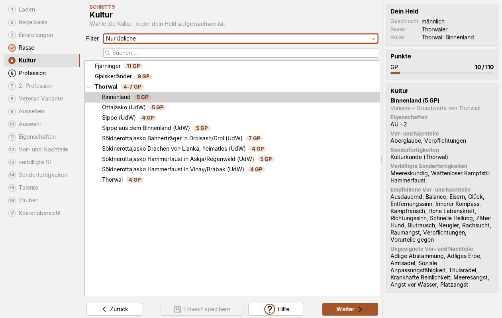
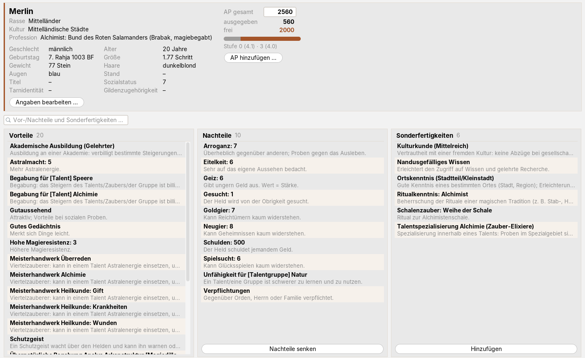

# Modern-UI für die Helden-Software (DSA 4.1)

Ein Plugin für die [Helden-Software](https://www.helden-software.de/): moderne Oberfläche, übersichtliches
Inventar und Ausrüstung, Tooltips, ein Verlauf zum Rückgängigmachen und ein neuer Heldenbogen. Es nutzt nur die
offizielle Plugin-Schnittstelle, verändert keine Heldendateien und lässt sich jederzeit auf das Original-Design
zurückschalten.

| Modern hell | Original |
|---|---|
|  |  |

## Funktionen

### Oberfläche

- **Drei Designs:** *Modern hell*, *Modern dunkel* und *Original* – für die ganze Software samt Dialogen.
- **Tabellen:** Zebra-Streifen, sortierbar per Spaltenkopf; *+1* und *SE* funktionieren auch sortiert.
- **Suche:** über Talenten und Zaubern, bei Talenten zusätzlich Schalter für die Talentgruppen.
- **Eigene Symbole** für hell und dunkel.
- **Jede Fenstergröße:** schon in der Startgröße wird nichts abgeschnitten.

Die neu gestalteten Reiter gibt es nur in den modernen Designs; im *Original* bleibt alles wie bisher. Änderungen
am Helden laufen immer über die Bedienelemente der Helden-Software.

| Modern dunkel | Neue Symbole |
|---|---|
|  |  |

### Helden erschaffen

Der Erschaffungs-Assistent in neuem Rahmen: links die Schritte mit Nummer, Häkchen und Warnung, in der Mitte der
Schritt mit kurzer Erklärung, rechts eine Info-Spalte mit dem bisherigen Helden, den Punkten (GP, AP, Nachteile …)
als Balken, Hinweisen der Regelprüfung und dem, was die gewählte Rasse, Kultur oder Profession mitbringt.
Regelbasis, Einstellungen und Aussehen sind als Karten aufgebaut, Rassen, Kulturen und Professionen zeigen ihre
GP-Kosten als Plakette. Die Tabellen (Eigenschaften, Vor-/Nachteile, Sonderfertigkeiten, Talente, Zauber, Kosten)
sind per Spaltenkopf sortierbar, z. B. nach Kosten oder Wert; Vor-/Nachteile, Sonderfertigkeiten, Talente und Zauber
haben eine Suche, Talente zusätzlich Schalter je Kategorie, Unterreiter zeigen die Trefferzahl.
Bei den Vor- und Nachteilen stehen die gewählten getrennt nach Vorteilen und Nachteilen nebeneinander, und
bereits gewählte werden auch nach dem Wechsel auf „Auch ungeeignete Vor- und Nachteile“ nicht erneut angeboten.
Gerechnet und geprüft wird weiter von der Helden-Software.
„Einen Helden eingeben“ und „Einen Helden editieren“ haben denselben Rahmen (Schrittleiste, Kopf, Info-Spalte,
Karten für Geschlecht/Setting und Person) und eine Suche bei Rasse, Kultur, Profession und Talenten.

### Allgemein

Links der Steckbrief mit allen Angaben (*Angaben bearbeiten …*), rechts die Abenteuerpunkte mit Balken,
Herkunfts-Tooltip und *AP hinzufügen …*. Darunter Vorteile, Nachteile und Sonderfertigkeiten in drei Spalten mit
Kurzbeschreibung und Suche.

### Eigenschaften

Eigenschaften mit Kosten und wofür sie gebraucht werden; LE, AU, AE und MR mit Rechenweg
(„(KO 12 + KO 12 + KK 11) / 2 = 17,5 → 18 · Modifikator +10“), verlorene AE mit *Zurückkaufen*;
Kampf-Basiswerte, Sozialstatus und Gilde.

### Inventar, Hinzufügen und Geldbörse

- **Inventar:** Gewicht und Geld auf einen Blick, Suche, Filter und Gruppierung nach Art.
- **Gegenstand hinzufügen:** Suche links, Werte rechts; *Kaufen* bezahlt direkt aus der Geldbörse.
- **Geldbörse:** Betrag eingeben, *Einnehmen* oder *Ausgeben* – gewechselt wird automatisch.

| Gegenstand hinzufügen | Geldbörse |
|---|---|
|  |  |

### Ausrüstung

Die drei Sets als Karten mit RS je Zone, Summen und angelegten Gegenständen; Ablegen mit ✕. Beim *Bearbeiten*
per Doppelklick oder Ziehen anlegen.

| Ausrüstung | Nahkampfwaffen bearbeiten |
|---|---|
|  |  |

### Kampfwerte

Basiswerte mit Formel, Nahkampf mit AT/PA-Verteilung als Balken und den Verteilungsregeln (gesperrtes „+“ mit
Begründung, **↺** gibt die TaP eines Talents wieder frei), Fernkampf mit Rechenweg.

### Tooltips und eigene Notizen

- **Tooltips** zu Talenten, SF, Vor-/Nachteilen, Zaubern, Eigenschaften und Basiswerten.
- **Herkunft** eines Werts (jede Steigerung mit Datum, Lernmethode und AP) und der Abenteuerpunkte.
- **Eigene Notizen** per Doppelklick oder `Strg+Umschalt+T` – auch auf dem Heldenbogen.
- *Erweiterte Tooltips anzeigen* schaltet alle Tooltips und Hinweise des Plugins ab.

| Herkunft eines Talentwerts | Herkunft der Abenteuerpunkte |
|---|---|
|  |  |

### Verlauf

Alle Steigerungen und Sonderfertigkeiten mit Datum, Lernmethode und AP. *Rückgängig machen …* nimmt die jeweils
letzte Änderung zurück und erstattet die AP (gerechnet von der Helden-Software, dauerhaft erst nach dem Speichern).

### Kompaktansicht

Der ganze Held auf einen Blick: Eigenschaften als Kacheln, Talente mit Balken, SF, Vor-/Nachteile, Kampf, Zauber
und Inventar.

### Moderner Heldenbogen

Neu gestalteter A4-Bogen in der Druckvorschau, mit Drucken und PDF: Werte, Kampf mit Trefferzonen, Talente nach
Gruppen, Magie-Seite, Inventar und Notizen mit Portrait. *Optionen ▾* blendet Teile ein und aus; *Original*
zeigt die bisherige Druckvorschau.

| Seite 1 | Kampf und Initiative |
|---|---|
|  |  |
| **Talente** | **Magie-Seite** |
|  |  |
| **Inventar, Geldbörse und Notizen** | |
|  | |

## Installation

1. Helden-Software beenden.
2. `ModernUI-Plugin.jar` aus den [Releases](../../releases) herunterladen.
3. In den Plugin-Ordner kopieren: Windows `C:\Users\<Name>\helden\plugins\`, macOS `/Users/<Name>/helden/plugins/`,
   Linux `~/helden/plugins/`.
4. Helden-Software starten.

Deinstallation: JAR löschen – die Helden-Software sieht danach aus wie vorher.

**Updates:** Mit *Einstellungen → Updater → Automatisch Updaten* installiert das Plugin neue Releases selbst
(geprüft per SHA-256, alte Version bleibt in `helden/plugins/modern-ui/update/`); von Hand über
*Erweiterungen → Modern-UI → Nach Updates suchen …*.

## Bedienung

| Was | Wie |
|---|---|
| Design, Tooltips an/aus | *Erweiterungen → Modern-UI* |
| AP hinzufügen | *Allgemein* → *AP hinzufügen …* oder „+350“ ins Feld *AP gesamt* |
| Eigene Notiz | Doppelklick auf einen Eintrag oder `Strg+Umschalt+T` |
| Ausrüstung anlegen / ablegen | *Ausrüstung* → *Bearbeiten* → Doppelklick oder Ziehen / rotes „✕“ |
| Steigerung rückgängig | *Verlauf* → Eintrag wählen → *Rückgängig machen …* |

Eigene Notizen liegen nur auf deinem Rechner in `helden/plugins/modern-ui/eigene-tooltips.tsv` – Auszüge aus
Regelbüchern bitte nicht weitergeben.

## Selbst bauen

JDK 8 oder neuer: `./build.sh` erzeugt `build/ModernUI-Plugin.jar` (FlatLaf von Maven Central oder aus
`FLATLAF_JAR`; die Helden-Software wird nicht benötigt). GitHub Actions hängt das JAR an veröffentlichte Releases.
Der Quellcode liegt in `src/main/java/de/modernhelden/`: je Reiter eine `…Layout.java`, dazu `Theme`, `TooltipHook`,
`Rueckgaengig`, `HeroPanel` (Kompaktansicht und Verlauf) sowie `print/` (Heldenbogen) und `update/`.

## Hinweise

- Die Kurzbeschreibungen sind eigene Zusammenfassungen, keine Regeltexte; maßgeblich sind die Regelbücher und
  die Berechnungen der Helden-Software.
- Die Helden-Software ist nicht Teil dieses Repositorys. Die Bilder zeigen Testhelden.
- *Das Schwarze Auge* und *Aventurien* sind Marken der Ulisses Spiele GmbH. Inoffizielles Fan-Projekt ohne
  Verbindung zu Ulisses Spiele oder den Entwicklern der Helden-Software.
- Enthält [FlatLaf](https://www.formdev.com/flatlaf/) (Apache-Lizenz 2.0, siehe `LICENSE-FlatLaf.txt`).
